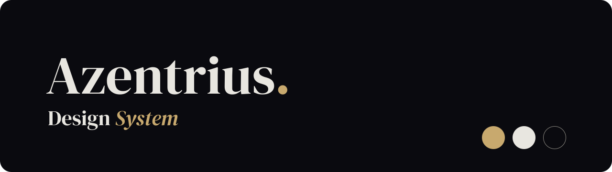

<p align="center"></p>

# Azentrius Design System

Das gemeinsame Design für alles, was unter Azentrius entsteht: Cockpit-Addons wie Cron Jobs und Image Update Monitor, Nextcloud-Apps, eigene Apps wie Stellwerk und Lautwerk samt dem Android-Auto-Prototyp von Lautwerk, die Projektseiten azentrius.com und das GitHub-Profil und das Azentrius Theme für Home Assistant. Es legt Farben, Schrift, Abstände, Bausteine, Statussprache und Ton fest, in vier Themen, die nach dem Ort gewählt werden, an dem eine Oberfläche läuft. Dieses Repo enthält das vollständige System: die Regeln, die Tokens als JSON und CSS, die CSS-Bausteine, die Schriften, die Icons und ein fertiges Android-Ressourcenpaket.

## Der Grundsatz: Azentrius erkennbar, der Gastgeber bestimmt Hell und Dunkel

- **Cockpit-Addons, eigene Apps, Projektseiten und Home Assistant** tragen die Azentrius-Themen mit Tinte, Papier und Gold, Schrift DM Sans. Hell oder Dunkel folgt in Cockpit dessen Einstellung, in Home Assistant der des Profils, in Apps und auf azentrius.com der des Geräts, im GitHub-Profil der von GitHub. So gilt es seit dem 12. Oktober 2026.
- **Zu Gast in Nextcloud** sieht eine App aus wie ein Teil des Gastgebers; Farben und Hell/Dunkel kommen von Nextcloud.
- **Überall gleich** bleibt, woran man Azentrius erkennt: dieselben Bausteine (`az-…`), derselbe Seitenrahmen aus Kopf, Reitern und Signatur „Azentrius.“ im Fuß, dieselbe Statussprache und derselbe knappe Ton.
- **Projektseiten** dürfen größer und markenbetonter auftreten; ihre Ausnahmen stehen in [projektseiten.md](projektseiten.md).

| Thema | gilt in | Aktionsfarbe `primary` |
|---|---|---|
| Azentrius dunkel | Cockpit-Addons, eigenen Apps, Projektseiten und Home Assistant im dunklen Modus | Gold `#c8a96e` mit Tinte darauf |
| Azentrius hell | Cockpit-Addons, eigenen Apps, Projektseiten und Home Assistant im hellen Modus | Tinte `#0a0a0f` mit Weiß darauf; Gold nur als Akzent |
| Cockpit hell / Cockpit dunkel | derzeit keiner Oberfläche; für Ansichten, die bewusst wie Cockpit selbst aussehen müssen | Cockpit-Blau (PatternFly 6, Wert für Wert) |

Das Thema richtet sich nach dem Ort, nie nach Geschmack.

## Auf einen Blick

| | |
|---|---|
| **Marke** | Tinte `#0a0a0f`, Papier `#e8e6e0`, Gold `#c8a96e`. Wortmarke „Azentrius.“ in DM Serif Display, der Punkt in Gold; das Zeichen „A.“ für Favicon und Avatar. Gold ist nie ein Status. |
| **Namen** | Produktnamen werden nicht übersetzt. Ein Zusatz steht kursiv in DM Serif Display und Gold (Image Update *Monitor*, Design *System*, Azentrius *Theme*), ein Name ohne Zusatz trägt den goldenen Punkt (Cron Jobs., Stellwerk., Lautwerk.). In reinem Text ohne beides. |
| **Schrift** | Addons und Apps: DM Sans, Code in Red Hat Mono. Markenton: DM Serif Display, kursiv für Namenszusätze wie „Monitor“ oder „System“. Projektseiten haben eine eigene Schriftgruppe. Alle Schriften liegen als Dateien bei, ohne externe Anfragen. |
| **Seitenrahmen** | Kopf in einer Zeile mit „Aktualisieren“ als einzigem gefüllten Button, darunter Reiter, im Fuß die Signatur. In allen Addons gleich. |
| **Raster** | Abstände 4 · 8 · 16 · 24 · 32 · 48, auf Projektseiten zusätzlich vier Abschnittsabstände. Radien 4 · 6 · 16 · 24 und Pille. Alles Bedienbare ist eine Pille. |
| **Ebenen** | `bg-page` → `bg-card` mit `line`-Rahmen → `bg-floating` mit Schatten. Karten liegen flach. |
| **Status** | Fünf Zustände mit festem Icon: ohne Wertung, gut, Hinweis, Achtung, Fehler. Nie nur Farbe, immer mit Icon und Wort. |
| **Barrierefreiheit** | Text mindestens 4,5:1, Rahmen, Fokus und Icons mindestens 3:1, in allen vier Themen geprüft; die eine bekannte Ausnahme ist in den Grundlagen begründet. Bewegung unter 150 ms und abschaltbar. Bedienziele: 44 px im mobilen Web, 48 dp unter Android. |

Alle Regeln mit Begründung stehen in [grundlagen.md](grundlagen.md).

## Inhalt

| Pfad | Inhalt |
|---|---|
| [`grundlagen.md`](grundlagen.md) | Das Regelwerk: Grundsatz, Farbe, Schrift, Raster, Statussprache, Sprache, Icons, Marke, Barrierefreiheit |
| [`projektseiten.md`](projektseiten.md) | Projektseiten (azentrius.com, GitHub-Profil): Schriftgruppe, Abstände, Eyebrows, Gold als Markenakzent, CTAs, Wortmarke |
| [`cockpit.md`](cockpit.md) | Einsatz in Cockpit-Addons ohne Build-Schritt: Dateien, gemeinsamer Seitenrahmen, Hell/Dunkel nach Cockpit-Einstellung |
| [`android.md`](android.md) | Native Android-Apps: Einheiten, 48-dp-Ziele, Bausteine mit allen Zuständen, Gesprächs-App, Telefonseiten des Android-Auto-Prototyps |
| [`android-auto.md`](android-auto.md) | Android Auto: was der Host zeichnet, Akzentfarben mit Kontrastprüfung, Icons, Inhalte und Abnahme im DHU für den Android-Auto-Prototyp von Lautwerk |
| [`home-assistant.md`](home-assistant.md) | Das Theme „Azentrius“ für Home Assistant: Dateien, Einbinden, Zuordnung der Tokens, was beim Gastgeber bleibt |
| [`weitere-apps.md`](weitere-apps.md) | Nextcloud-Apps, eigene Apps (Ionic) und neue Gastgeber |
| [`tokens.json`](tokens.json) | Alle Tokens mit Werten je Thema und einer Verwendungsregel pro Token |
| [`tokens.css`](tokens.css) | Dieselben Tokens als CSS-Variablen, erzeugt aus `tokens.json` |
| [`components/`](components) | `bundle.css` mit allen `az-`-Bausteinen; je Baustein eine README mit Regeln und eine HTML-Vorschau |
| [`fonts/`](fonts) | Web-Schriften als WOFF2 (DM Sans, DM Serif Display, Red Hat Text, Display, Mono) |
| [`assets/Marke/`](assets/Marke) | Das Zeichen „A.“ für Azentrius selbst |
| [`assets/Icons/`](assets/Icons) | 35 Icons aus `@patternfly/react-icons` als SVG mit Bedeutung, Herkunft und Lizenz |
| [`assets/App-Icons/`](assets/App-Icons) | Zeichen der eigenen Apps als Vorlagen, bisher Lautwerk („Sprechblase mit Punkt“) und Stellwerk („Formsignal mit Punkt“) |
| [`android/`](android) | `res/font` (TTF), `res/drawable` (Vector-Drawables) und Lizenzen, direkt in ein App-Modul kopierbar |
| [`android/apps/lautwerk/`](android/apps/lautwerk) | App-Symbol, Startfarbe und Benachrichtigungssymbol nur für Lautwerk |
| [`home-assistant/`](home-assistant) | Das Theme `themes/azentrius.yaml` und `www/azentrius/azentrius.js`, das die Schriften lädt, im Aufbau des Konfigurationsordners von Home Assistant |
| [`scripts/tokens-css.py`](scripts/tokens-css.py) | Erzeugt `tokens.css` aus `tokens.json` |
| [`scripts/home-assistant-theme.py`](scripts/home-assistant-theme.py) | Erzeugt das Home-Assistant-Theme aus `tokens.json` und prüft dessen Kontraste |
| [`scripts/app-icon-lautwerk.py`](scripts/app-icon-lautwerk.py) | Erzeugt alle Dateien des Lautwerk-Symbols |
| [`scripts/app-icon-stellwerk.py`](scripts/app-icon-stellwerk.py) | Erzeugt die Dateien des Stellwerk-Zeichens |
| [`LICENSE`](LICENSE) | Rechte am Designsystem: Code unter Apache-2.0, alles andere alle Rechte vorbehalten |
| [`LICENSES/`](LICENSES) | Lizenztexte: Apache-2.0, Schriften und Icons |

Bausteine: Alert, Button, Card, EmptyState, Label, Modal, PageHeader, Signature, Switch, Table, Tabs und TextField. Dazu kommt das Cover als Titelbild des Systems.

## Einsetzen

### Web

`tokens.css` und `components/bundle.css` einbinden, das Thema am `<html>`-Element wählen. `tokens.css` lädt die Schriften relativ aus `fonts/`, deshalb liegen beide Ordner nebeneinander.

```html
<html lang="de" data-theme="azentrius-dunkel">
<head>
  <link rel="stylesheet" href="tokens.css">
  <link rel="stylesheet" href="components/bundle.css">
</head>
<body>
  <div class="az-page">
    <section class="az-card">…</section>
    <footer class="az-signature">…</footer>
  </div>
</body>
</html>
```

Ohne `data-theme` gelten die Werte von „Cockpit hell“; Addons und Apps setzen deshalb immer ein Azentrius-Thema. Mögliche Werte sind `azentrius-dunkel`, `azentrius-hell`, `cockpit-hell` und `cockpit-dunkel`.

### Cockpit-Addons

Ein Addon trägt die Azentrius-Themen und folgt dabei Cockpits eigenem Hell/Dunkel-Schalter. Es bringt DM Sans, DM Serif Display und Red Hat Mono als Teilmengen selbst mit. Wie `azentrius.css` und `azentrius-theme.js` entstehen und eingebunden werden und wie der gemeinsame Seitenrahmen aussieht, steht in [cockpit.md](cockpit.md).

### Android

1. `android/res/font/` und `android/res/drawable/` in das `res/`-Verzeichnis des App-Moduls kopieren.
2. Für Lautwerk zusätzlich `android/apps/lautwerk/res/` dorthin kopieren und im Manifest `android:icon="@mipmap/ic_launcher"` und `android:roundIcon="@mipmap/ic_launcher_round"` setzen. Andere Apps übernehmen diesen Ordner nicht.
3. Die Dateien aus `android/LICENSES/` in die App übernehmen, etwa auf eine Seite „Lizenzen“.
4. Umsetzen nach [android.md](android.md): 1 px = 1 dp, Schrift in sp, Farben aus `tokens.json`. Dort stehen auch die Zuordnung zu Material 3 sowie Startbild und Benachrichtigung.

Ein Grundsatz aus `android.md` gilt für jede Umsetzung: **Das Design ändert kein Verhalten.** Widerspricht eine Regel einer bestehenden Funktion, gilt die Funktion; die Regel wird hier korrigiert.

### Home Assistant

1. `python3 scripts/home-assistant-theme.py --config <ordner>` legt `themes/azentrius.yaml` und `www/azentrius/` mit Skript, Schriften und Lizenztexten an.
2. Beides in den Konfigurationsordner von Home Assistant kopieren (`/config`).
3. In `configuration.yaml` unter `frontend:` die Themes mit `themes: !include_dir_merge_named themes` laden und `extra_module_url: [/local/azentrius/azentrius.js]` eintragen; die Schriften wirken nach einem Neustart.
4. „Themes neu laden“ ausführen und „Azentrius“ im Profil wählen, für alle mit `frontend.set_theme`.

Hell und Dunkel folgen der Einstellung im Profil. Gerätefarben, Größen und Abstände bleiben die von Home Assistant; Einzelheiten stehen in [home-assistant.md](home-assistant.md).

Öffentlich gibt es das Theme unter dem Produktnamen Azentrius Theme als [`Azentrius/home-assistant-theme`](https://github.com/Azentrius/home-assistant-theme), installierbar über HACS als benutzerdefiniertes Repository. Es bekommt die mit `--lang en` erzeugten Dateien; Änderungen entstehen hier.

### Android Auto

Im Auto zeichnet Android Auto die Oberfläche aus Vorlagen der Car App Library. Das Smartphone-Design wird deshalb nicht übertragen. Die App liefert Inhalte und fordert ein Akzentfarbpaar aus diesem System an. Alles andere bestimmt der Host, auch den Hintergrund und ob das Farbpaar überhaupt erscheint. Die verbindlichen Vorgaben, die Kontrastberechnung, die Abnahmekriterien und das Ergebnis der Abnahme 0.1.14 für den Desktop Head Unit Emulator stehen in [android-auto.md](android-auto.md). Der DHU-Prototyp ist ein lokales Experiment; das Designsystem behauptet keine unterstützte Kategorie und keine Zulassung.

### Tokens in eigenen Werkzeugen

`tokens.json` ist eine Liste, keine verschachtelte Zuordnung:

```json
{
  "color": {
    "themes": [{ "id": "azentrius-dunkel", "name": "Azentrius dunkel" }],
    "tokens": [{ "name": "primary", "value": { "azentrius-dunkel": "#c8a96e" }, "usage": "Hauptaktion …" }]
  },
  "type":    { "fonts": [], "families": {}, "groups": [{ "name": "Azentrius", "family": "app", "styles": [] }] },
  "spacing": { "tokens": [{ "name": "space-md", "value": "16px", "usage": "…" }] },
  "radius":  { "tokens": [] },
  "shadow":  { "tokens": [] }
}
```

Achtstellige Hex-Werte stehen in CSS-Reihenfolge `#RRGGBBAA`. Android erwartet `0xAARRGGBB`.

## Pflege

- **Eine Quelle.** Maßgeblich ist die Arbeitsfassung des Azentrius-Designsystems außerhalb dieses Repos. Änderungen entstehen nur dort und werden von dort in dieses Repo übertragen. `grundlagen.md` entspricht dort der Startseite des Systems, alle anderen Dateien tragen denselben Pfad.
- **Projekte lesen nur.** Apps, Addons und die Werkzeuge, mit denen sie entstehen, setzen das System um, ändern dieses Repo aber nicht. Finden sie eine Lücke oder einen Widerspruch, geht das als Hinweis an die Quelle, nicht als Änderung hierher.
- `tokens.css` wird nie von Hand geändert. Nach jeder Änderung an `tokens.json` wird sie mit `python3 scripts/tokens-css.py` neu erzeugt.
- Dasselbe gilt für die App-Zeichen: Die Dateien von Lautwerk entstehen mit `python3 scripts/app-icon-lautwerk.py`, die von Stellwerk mit `python3 scripts/app-icon-stellwerk.py`.
- Auch das Home-Assistant-Theme unter `home-assistant/` wird nach jeder Änderung an `tokens.json` mit `python3 scripts/home-assistant-theme.py` neu erzeugt. Das Skript bricht ab, wenn ein Farbpaar des Themes unter seiner Kontrastgrenze liegt.
- Jede neue Farbe oder jedes neue Farbpaar wird vor der Aufnahme in allen vier Themen auf Kontrast geprüft: 4,5:1 für Text, 3:1 für Rahmen, Fokus und Icons.

## Lizenzen

**Der Code steht unter Apache-2.0**, so wie in den Addons, die ihn ausliefern: `tokens.json`, `tokens.css`, `components/bundle.css` und der Code von `azentrius-theme.js` in `cockpit.md`, ebenso die daraus erzeugten `azentrius.css` und `azentrius-theme.js` der Addons und das Home-Assistant-Theme unter `home-assistant/`. Der Lizenztext liegt in [`LICENSES/Apache-2.0.txt`](LICENSES/Apache-2.0.txt).

**Alles andere ist nicht frei lizenziert:** Regeln und Texte, Komponenten-Beschreibungen und -Vorschauen, Skripte, Grafiken sowie die Marke mit der Wortmarke „Azentrius.“, dem Zeichen „A.“, den Zeichen der Apps und den Produktnamen. Daran sind alle Rechte vorbehalten; ohne schriftliche Zustimmung des Rechteinhabers ist jede Nutzung außerhalb seiner eigenen Projekte untersagt. Die Apache-Lizenz räumt keine Rechte an der Marke ein. Einzelheiten stehen in [`LICENSE`](LICENSE).

Bestandteile Dritter behalten ihre eigenen Lizenzen:

| Bestandteil | Lizenz | Datei |
|---|---|---|
| DM Sans | SIL Open Font License 1.1 | [`LICENSES/OFL-DM-Sans.txt`](LICENSES/OFL-DM-Sans.txt) |
| DM Serif Display | SIL Open Font License 1.1 | [`LICENSES/OFL-DM-Serif-Display.txt`](LICENSES/OFL-DM-Serif-Display.txt) |
| Red Hat Text, Display, Mono | SIL Open Font License 1.1 | [`LICENSES/OFL-Red-Hat-Fonts.txt`](LICENSES/OFL-Red-Hat-Fonts.txt) |
| Icons aus Font Awesome Free 5.15.4, über `@patternfly/react-icons` 6.4.0: alle außer `pending` | CC BY 4.0, © Fonticons, Inc., Namensnennung Pflicht | [`LICENSES/CC-BY-4.0-Font-Awesome.txt`](LICENSES/CC-BY-4.0-Font-Awesome.txt) |
| PatternFly-Icon `pending` aus `@patternfly/react-icons` 6.4.0 | MIT, © Red Hat, Inc. | [`LICENSES/MIT-PatternFly-Icons.txt`](LICENSES/MIT-PatternFly-Icons.txt) |

Die Android-TTF-Dateien sind statische Schnitte (400, 500, 600) derselben Schriften wie im Web und stehen ebenfalls unter der OFL.
