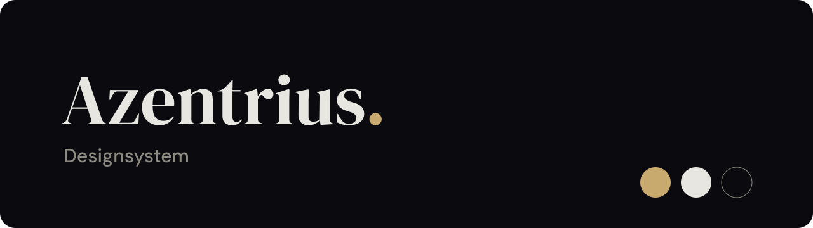

<p align="center"></p>

# Azentrius Designsystem

Das gemeinsame Design für alles, was unter Azentrius entsteht: Cockpit-Addons wie cronctl und Image-Updates, Nextcloud-Apps und eigene Apps wie die Android-Gesprächs-App samt ihrem Android-Auto-Prototyp. Es legt Farben, Schrift, Abstände, Bausteine, Statussprache und Ton fest, in vier Themen, die nach dem Ort gewählt werden, an dem eine Oberfläche läuft. Dieses Repo enthält das vollständige System: die Regeln, die Tokens als JSON und CSS, die CSS-Bausteine, die Schriften, die Icons und ein fertiges Android-Ressourcenpaket.

## Der Grundsatz: Zu Gast nativ, zu Hause Azentrius

- **Zu Gast** (Cockpit, Nextcloud): Ein Addon sieht aus wie ein Teil des Gastgebers. Farben, Schriften, Radien und Hell/Dunkel kommen vom Gastgeber.
- **Zu Hause** (eigene Apps, azentrius.de): Es gelten die Azentrius-Themen mit Tinte, Papier und Gold, Schrift DM Sans.
- **Überall gleich** bleibt, woran man Azentrius erkennt: dieselben Bausteine (`az-…`), dieselbe Statussprache, derselbe knappe Ton und die Signatur „Azentrius.“ im Seitenfuß.

| Thema | gilt in | Aktionsfarbe `primary` |
|---|---|---|
| Cockpit hell / Cockpit dunkel | Cockpit-Addons, nach Cockpits Einstellung | Cockpit-Blau (PatternFly 6, Wert für Wert) |
| Azentrius dunkel | eigenen Apps im dunklen Modus | Gold `#c8a96e` mit Tinte darauf |
| Azentrius hell | eigenen Apps im hellen Modus | Tinte `#0a0a0f` mit Weiß darauf; Gold nur als Akzent |

Das Thema richtet sich nach dem Ort, nie nach Geschmack.

## Auf einen Blick

| | |
|---|---|
| **Marke** | Tinte `#0a0a0f`, Papier `#e8e6e0`, Gold `#c8a96e`. Wortmarke „Azentrius.“ in DM Serif Display, der Punkt in Gold. Gold ist nie ein Status. |
| **Schrift** | Cockpit: Red Hat Text, Display und Mono. Eigene Apps: DM Sans. Markenton: DM Serif Display. Alle Schriften liegen als Dateien bei, ohne externe Anfragen. |
| **Raster** | Abstände 4 · 8 · 16 · 24 · 32 · 48. Radien 4 · 6 · 16 · 24 und Pille. Alles Bedienbare ist eine Pille. |
| **Ebenen** | `bg-page` → `bg-card` mit `line`-Rahmen → `bg-floating` mit Schatten. Karten liegen flach. |
| **Status** | Fünf Zustände mit festem Icon: ohne Wertung, gut, Hinweis, Achtung, Fehler. Nie nur Farbe, immer mit Icon und Wort. |
| **Barrierefreiheit** | Text mindestens 4,5:1, Rahmen, Fokus und Icons mindestens 3:1, in allen vier Themen geprüft; die eine bekannte Ausnahme ist in den Grundlagen begründet. Bewegung unter 150 ms und abschaltbar. Bedienziele: 44 px im mobilen Web, 48 dp unter Android. |

Alle Regeln mit Begründung stehen in [grundlagen.md](grundlagen.md).

## Inhalt

| Pfad | Inhalt |
|---|---|
| [`grundlagen.md`](grundlagen.md) | Das Regelwerk: Grundsatz, Farbe, Schrift, Raster, Statussprache, Sprache, Icons, Marke, Barrierefreiheit |
| [`cockpit.md`](cockpit.md) | Einsatz in Cockpit-Addons ohne Build-Schritt, Hell/Dunkel nach Cockpit-Einstellung |
| [`android.md`](android.md) | Native Android-Apps: Einheiten, 48-dp-Ziele, Bausteine mit allen Zuständen, Gesprächs-App |
| [`android-auto.md`](android-auto.md) | Android Auto: was der Host zeichnet, Akzentfarben mit Kontrastprüfung, Icons, Inhalte und Abnahme im DHU für den OpenAuto-AI-Prototyp |
| [`weitere-apps.md`](weitere-apps.md) | Nextcloud-Apps, eigene Apps (Ionic) und neue Gastgeber |
| [`tokens.json`](tokens.json) | Alle Tokens mit Werten je Thema und einer Verwendungsregel pro Token |
| [`tokens.css`](tokens.css) | Dieselben Tokens als CSS-Variablen, erzeugt aus `tokens.json` |
| [`components/`](components) | `bundle.css` mit allen `az-`-Bausteinen; je Baustein eine README mit Regeln und eine HTML-Vorschau |
| [`fonts/`](fonts) | Web-Schriften als WOFF2 (DM Sans, DM Serif Display, Red Hat Text, Display, Mono) |
| [`assets/Icons/`](assets/Icons) | 30 PatternFly-Icons als SVG mit ihrer Bedeutung |
| [`assets/App-Icons/`](assets/App-Icons) | Zeichen der eigenen Apps als Vorlagen, bisher OpenAuto AI („Sprechblase mit Punkt“) |
| [`android/`](android) | `res/font` (TTF), `res/drawable` (Vector-Drawables) und Lizenzen, direkt in ein App-Modul kopierbar |
| [`android/apps/openauto-ai/`](android/apps/openauto-ai) | App-Symbol, Startfarbe und Benachrichtigungssymbol nur für OpenAuto AI |
| [`scripts/tokens-css.py`](scripts/tokens-css.py) | Erzeugt `tokens.css` aus `tokens.json` |
| [`scripts/app-icon-openauto.py`](scripts/app-icon-openauto.py) | Erzeugt alle Dateien des OpenAuto-AI-Symbols |
| [`LICENSE`](LICENSE) | Rechte am Designsystem: alle Rechte vorbehalten |
| [`LICENSES/`](LICENSES) | Lizenzen der Schriften und Icons |

Bausteine: Alert, Button, Card, EmptyState, Label, Modal, PageHeader, Signature, Switch, Table und TextField. Dazu kommt das Cover als Titelbild des Systems.

## Einsetzen

### Web

`tokens.css` und `components/bundle.css` einbinden, das Thema am `<html>`-Element wählen. `tokens.css` lädt die Schriften relativ aus `fonts/`, deshalb liegen beide Ordner nebeneinander.

```html
<html lang="de" data-theme="azentrius-dunkel">
<head>
  <link rel="stylesheet" href="tokens.css">
  <link rel="stylesheet" href="components/bundle.css">
</head>
<body>
  <div class="az-page">
    <section class="az-card">…</section>
    <footer class="az-signature">…</footer>
  </div>
</body>
</html>
```

Ohne `data-theme` gelten die Werte von „Cockpit hell“. Mögliche Werte sind `cockpit-hell`, `cockpit-dunkel`, `azentrius-dunkel` und `azentrius-hell`.

### Cockpit-Addons

Ein Addon folgt Cockpits eigenem Hell/Dunkel-Schalter und nutzt die Red-Hat-Schriften, die Cockpit mitliefert. Wie `azentrius.css` und `azentrius-theme.js` entstehen und eingebunden werden, steht in [cockpit.md](cockpit.md).

### Android

1. `android/res/font/` und `android/res/drawable/` in das `res/`-Verzeichnis des App-Moduls kopieren.
2. Für OpenAuto AI zusätzlich `android/apps/openauto-ai/res/` dorthin kopieren und im Manifest `android:icon="@mipmap/ic_launcher"` und `android:roundIcon="@mipmap/ic_launcher_round"` setzen. Andere Apps übernehmen diesen Ordner nicht.
3. Die Dateien aus `android/LICENSES/` in die App übernehmen, etwa auf eine Seite „Lizenzen“.
4. Umsetzen nach [android.md](android.md): 1 px = 1 dp, Schrift in sp, Farben aus `tokens.json`. Dort stehen auch die Zuordnung zu Material 3 sowie Startbild und Benachrichtigung.

Ein Grundsatz aus `android.md` gilt für jede Umsetzung: **Das Design ändert kein Verhalten.** Widerspricht eine Regel einer bestehenden Funktion, gilt die Funktion; die Regel wird hier korrigiert.

### Android Auto

Im Auto zeichnet Android Auto die Oberfläche aus Vorlagen der Car App Library. Das Smartphone-Design wird deshalb nicht übertragen. Die App liefert Inhalte und fordert ein Akzentfarbpaar aus diesem System an. Alles andere bestimmt der Host, auch den Hintergrund und ob das Farbpaar überhaupt erscheint. Die verbindlichen Vorgaben, die Kontrastberechnung, die Abnahmekriterien und das Ergebnis der Abnahme 0.1.14 für den Desktop Head Unit Emulator stehen in [android-auto.md](android-auto.md). Der DHU-Prototyp ist ein lokales Experiment; das Designsystem behauptet keine unterstützte Kategorie und keine Zulassung.

### Tokens in eigenen Werkzeugen

`tokens.json` ist eine Liste, keine verschachtelte Zuordnung:

```json
{
  "color": {
    "themes": [{ "id": "azentrius-dunkel", "name": "Azentrius dunkel" }],
    "tokens": [{ "name": "primary", "value": { "azentrius-dunkel": "#c8a96e" }, "usage": "Hauptaktion …" }]
  },
  "type":    { "fonts": [], "families": {}, "groups": [{ "name": "Azentrius", "family": "app", "styles": [] }] },
  "spacing": { "tokens": [{ "name": "space-md", "value": "16px", "usage": "…" }] },
  "radius":  { "tokens": [] },
  "shadow":  { "tokens": [] }
}
```

Achtstellige Hex-Werte stehen in CSS-Reihenfolge `#RRGGBBAA`. Android erwartet `0xAARRGGBB`.

## Pflege

- **Claude führt.** Die Quelle ist das Azentrius-Designsystem in Claude. Änderungen entstehen nur dort und werden von dort in dieses Repo übertragen. `grundlagen.md` entspricht dort der Startseite des Systems, alle anderen Dateien tragen denselben Pfad.
- **Andere Werkzeuge lesen nur.** ChatGPT und andere Werkzeuge setzen das System um, ändern dieses Repo aber nicht. Finden sie eine Lücke oder einen Widerspruch, geht das als Hinweis an die Quelle in Claude, nicht als Änderung hierher.
- `tokens.css` wird nie von Hand geändert. Nach jeder Änderung an `tokens.json` wird sie mit `python3 scripts/tokens-css.py` neu erzeugt.
- Dasselbe gilt für das OpenAuto-AI-Symbol: Alle seine Dateien entstehen mit `python3 scripts/app-icon-openauto.py`.
- Jede neue Farbe oder jedes neue Farbpaar wird vor der Aufnahme in allen vier Themen auf Kontrast geprüft: 4,5:1 für Text, 3:1 für Rahmen, Fokus und Icons.

## Lizenzen

**Das Designsystem selbst ist nicht frei lizenziert.** Regeln, Tokens, CSS, Komponenten, Skripte, Grafiken sowie Marke und Wortmarke „Azentrius.“ sind urheberrechtlich geschützt, alle Rechte vorbehalten. Ohne schriftliche Zustimmung des Rechteinhabers ist jede Nutzung außerhalb seiner eigenen Projekte untersagt. Einzelheiten stehen in [`LICENSE`](LICENSE).

Bestandteile Dritter behalten ihre eigenen Lizenzen:

| Bestandteil | Lizenz | Datei |
|---|---|---|
| DM Sans | SIL Open Font License 1.1 | [`LICENSES/OFL-DM-Sans.txt`](LICENSES/OFL-DM-Sans.txt) |
| DM Serif Display | SIL Open Font License 1.1 | [`LICENSES/OFL-DM-Serif-Display.txt`](LICENSES/OFL-DM-Serif-Display.txt) |
| Red Hat Text, Display, Mono | SIL Open Font License 1.1 | [`LICENSES/OFL-Red-Hat-Fonts.txt`](LICENSES/OFL-Red-Hat-Fonts.txt) |
| Icons aus `@patternfly/react-icons` 6.4.0 | MIT, © Red Hat, Inc. | [`LICENSES/MIT-PatternFly-Icons.txt`](LICENSES/MIT-PatternFly-Icons.txt) |

Die Android-TTF-Dateien sind statische Schnitte (400, 500, 600) derselben Schriften wie im Web und stehen ebenfalls unter der OFL.
