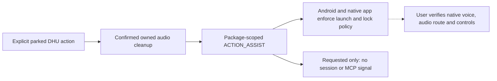

# Public assistant entry experiment

This extends the unmerged 0.3.3 handoff branch after PR #51. The product goal is native personal
voice conversations, selected and operated from the car without handling the phone. Opening an
app is only one milestone. The existing API mode is not a replacement for that goal.

**Measured result:** the [Pixel 10 Pro / Android 17 comparison](evidence/assist-0.3.3/README.md)
did not start native Voice in either app, including with each app selected as default assistant.
The tested route is NO-GO for direct voice start. The implementation remains an opt-in diagnostic.

A subsequent [read-only native settings inspection](evidence/native-voice-settings-2026-11-01/README.md)
found no auto-start switch in the installed voice settings. Both official home widgets expose a
voice action. A separate [authorized widget test](evidence/native-widget-voice-2026-11-01/README.md)
then entered native Voice twice per app. The visible native End action released microphone access
each time, and a second widget start worked. These are phone-widget results, not a public inter-app
voice API or an Android Auto start/stop solution. No question or answer exchange was tested.

The [shortcut and control-access audit](evidence/control-access-2026-11-01/README.md) then found
working native launcher shortcuts and app-published Hang up notification actions for both apps.
The existing Lautwerk UID cannot query either shortcuts or foreign media sessions. This supports
a separately consented, isolated prototype using public shortcuts and notification actions, not
a ready-to-use car mode. Notification actions were inspected with explicit consent, not invoked.

## Candidate and boundaries

Read-only package-manager queries on the Pixel 10 Pro found an exported `ACTION_ASSIST` activity
in each installed official app. The Android SDK documents
[`Intent.ACTION_ASSIST`](https://developer.android.com/reference/android/content/Intent#ACTION_ASSIST).
It requests assistance, returns no session acknowledgement, and does not promise voice mode.
The experiment sends this public action with the selected package and `FLAG_ACTIVITY_NEW_TASK`
from the application context. It supplies no context, content, private component, URI or extras.
Resolution checks the default intent filter, export status and caller permission. There is no
automatic fallback to the package launcher.

Both apps also declare a `VoiceInteractionService`, protected by `BIND_VOICE_INTERACTION`.
That is a system-managed assistant integration, not a service Lautwerk may directly bind to.
The implementation changes no default-assistant role or setting. A separate user-authorized
comparison temporarily selected each app through Android settings and restored Google afterwards.
The observed additional Claude
`android.intent.action.VOICE_ASSIST` filter is not used: AOSP marks the constant `@hide` and
`@SystemApi`, unlike public `ACTION_ASSIST`. A manifest match alone does not make a private API
supported. Neither tested package resolved the public `ACTION_VOICE_COMMAND` action.

Sources: [VoiceInteractionService](https://developer.android.com/reference/android/service/voice/VoiceInteractionService),
[AOSP Intent declarations](https://android.googlesource.com/platform/frameworks/base.git/+/master/core/java/android/content/Intent.java).



## Isolation and build

Both properties are required:

```powershell
.\gradlew.bat -PcarHandoffExperiment=true -PcarHandoffEntry=assist :prototype-app:assembleDhuDebug :prototype-app:assembleDhuDebugAndroidTest
```

`carHandoffEntry` accepts `launcher` (default) or `assist`. Without `carHandoffExperiment=true`
and a debuggable DHU app, no additional car action is enabled. The normal API action, selection,
voice choice, storage and main phone app remain unchanged. The assist build labels its two
experimental actions **Start ChatGPT** / **Start Claude** and explicitly says that voice start
is not yet proven. It reports only **Assist requested, not confirmed** after dispatch.

The same audio-release fence, cancellation, timeout and duplicate-click guards cover both routes.
After a request, leave and re-enter the page to explicitly request another attempt. No automatic
relaunch, network retry, session replay, microphone monitoring or notification reader is added.
There is no external Stop button because no supported stop contract has been established.

The launcher route retains its early locked-phone refusal. The assist route delegates that
decision to Android and the native app, without keyguard dismissal, show-when-locked flags,
privileged permissions or changes to the lock policy. A normal return can still leave a request
blocked behind the keyguard. A visible app, microphone indicator or audio focus does not prove
a usable native conversation. The car actions remain parked-only until an allowed moving-car
interaction has been established; removing that guard alone would not solve the product goal.

## Device procedure

Use the existing [handoff install and cleanup procedure](HANDOFF_EXPERIMENT.md). Install with
ordinary `adb install -r`, preserving data and installer policy. Stop on a signature conflict.
Keep the previous APK for rollback. Capture system settings and assistant role before/after.
Do not change provider settings or approve MCP requests. End other Lautwerk/native sessions first.

Run fixture instrumentation before the live test. It never launches an official app. Then start
the real DHU, use its actual actions, and retain only fixed dispatch events and the existing
sanitized visibility observer output. Do not use shell/instrumentation launches as proof of a
DHU start. Record official app, OS, Android Auto, DHU and Car API versions. No native screenshots,
conversation text, audio, notification content or account identifiers belong in the evidence.

Coordinate each result with the user before altering the phone or proceeding to the other app.
A real native conversation can send microphone audio to the selected provider; only the user
speaks the agreed neutral test question after the launch check. Do not send prompts automatically.

| Test | Acceptance | Evidence type |
| --- | --- | --- |
| Public intent | Exactly ASSIST + selected package + NEW_TASK; no extras, component or fallback | Fixture test and fixed dispatch event |
| Audio ownership | No dispatch before own release acknowledgement; timeout/failure cancels | Existing JVM and car fixtures; live acoustic check separately |
| Unlocked start, each app | Native Voice begins without a phone tap | Real DHU action plus explicit user observation |
| Routing | Question through PC microphone, audible native answer through DHU speakers | User observation; visibility alone is insufficient |
| Screen off | Session continues with phone locked and no phone interaction | User observation, distinct from cold locked start |
| Locked start | From an idle locked phone, native session starts without unlocking | Separate real DHU attempt; never bypass keyguard |
| End and restart | User can stop and restart without touching phone | Native voice command or documented car control, actually verified |
| Permissions/MCP | Honest limitation; no guessed detection or automatic approval | No listener/approval implementation; manual test only if separately agreed |
| Regression | Existing API template and lifecycle fixtures, JVM, lint and debug builds pass | Automated reports |

Calls, headsets and moving-vehicle tests remain deferred. A GO for voice start is narrower than
a GO for a complete hands-free personal assistant. End/restart, locked starts, recovery and
permissions must be assessed separately. A failure is a result for the tested app/version/host,
not proof that every future public integration is impossible.
