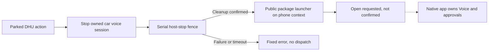

# Android Auto handoff experiment

Version 0.3.3, based on `main` at `d00d493` (the merged architecture spike, PR #51).
The initial experiment tests app opening from the DHU. A separate opt-in now tests the public
Android assist entry; neither route implements external voice-session control.
See [the architecture boundaries](PERSONAL_ASSISTANT_SPIKE.md).
Measured Pixel 10 Pro / Android 17 results and remaining acceptance work are in the
[2026-11-01 test report](evidence/handoff-0.3.3/README.md).
The next stage is described in [the public assist experiment](ASSIST_EXPERIMENT.md).
The later, separately gated [native control prototype](NATIVE_CONTROLS_EXPERIMENT.md) is distinct
from both routes described below and adds no behavior to the default build.

## Scope and isolation

Build with `-PcarHandoffExperiment=true` to enable the extra entry in `dhuDebug` only. The default
is false; the standard car screen still has its existing single Start/End action. The opt-in also
requires a debuggable application. The phone assistant and offline phone prototype gain no new UI.
No changes to API providers, model selection, voice choice, stored keys or chat history.

The opted-in car screen adds **Open assistants**, leading to a small `MessageTemplate` with
**Open ChatGPT** and **Open Claude**. All three added click actions use the host's parked-only
listener. Existing title and gold/bronze requests remain. This is an explicit experimental exception
to the single-action design rule B1; it is not a new upstream design rule. B2/B3 remain unchanged.
No new colors, icons or layout values are introduced.



Why a second page: the host allows at most two body actions and only one titled action in the
header action strip. It cannot show the existing conversation action plus both named destinations
in those locations without changing the arrangement. See
[MessageTemplate.Builder](https://developer.android.com/reference/androidx/car/app/model/MessageTemplate.Builder).

## Public Android route and honest results

`AndroidAssistantLauncher` uses `PackageManager.getLaunchIntentForPackage`, then
`Context.startActivity` with `FLAG_ACTIVITY_NEW_TASK`, from the phone application context. Narrow
package queries cover `com.openai.chatgpt` and `com.anthropic.claude`. No extracted component names,
custom Voice URI, notification listener, usage access, role change, special background-launch
permission, root or accessibility service is used. `CarContext.startCarApp` is not used to project
an ordinary phone app.

The application context avoids inheriting the CarContext's virtual display. The library itself
uses a default-display launch for its own phone permission UI; see
[the AndroidX CarContext source](https://github.com/androidx/androidx/blob/androidx-main/car/app/app/src/main/java/androidx/car/app/CarContext.java).
This choice does not grant background-launch permission or change Android's policy.

This direct activity route is public on all supported Android versions. It deliberately lets
Android enforce background-launch policy; it does not borrow ADB or instrumentation privileges.
See [PackageManager](https://developer.android.com/reference/android/content/pm/PackageManager#getLaunchIntentForPackage(java.lang.String))
and [Android activity launch restrictions](https://developer.android.com/guide/components/activities/secure-bal).
The generic launcher can restore an existing screen or native auto-start behavior. It does not
guarantee a new conversation, Voice, authentication or an MCP connection.

Result handling:

- Locked phone: ask the user to unlock it while parked; do not launch behind the keyguard.
- No launch intent / activity no longer present: explain that the official app is unavailable.
- Security or launch exception: fixed text explains that Android could not open the app.
- Normal return: show **Open requested, not confirmed**. Android can suppress a background start
  without throwing. The message explains this and asks the user to check the phone while parked.
- Never show external Listening/Speaking/Connected or a working external End control. No guessed
  timeout converts an unconfirmed launch into success or a definite Android rejection.
- Advice about approvals is general. The official app owns review/confirmation. No pending-MCP
  detection, notification reading or automatic approval exists.

After a dispatched request the two actions are disabled until the user leaves and reopens the
page, avoiding repeated dispatch from cached/double clicks. No automatic retry on reconnection,
process restart or return from the native app.

## Audio release and remaining boundary

The experiment stops the bound car voice service before opening an app. The service excludes new
starts during that handoff. TTS stop/shutdown, recognizer cancel/destroy, pipe closure and focus
release are requested on the owning thread. A process-owned `AudioReleaseFence` runs after queued
CarAudioRecord stop work on the same serial control executor, then reports back to the main thread.
An inactive UI state alone is never an acknowledgement.

Cleanup exceptions, a failed TTS stop and failed focus abandonment latch an unsafe state for the process; later
handoffs fail closed until a process restart. A 15-second cleanup deadline cancels the attempt,
without claiming that hardware released successfully. The deadline is an engineering limit, not
a delay used to infer release. Screen exit and stale callbacks cannot launch the destination.
The existing API flow retains its cancellation behavior; the extra failure tracking affects only
handoff eligibility.

The acknowledgement covers completion of Lautwerk's release calls, not a physical speaker-drain
measurement or another application's microphone. Device tests must check for overlapping output.
The independently installed main assistant and old test packages have private services. This
experiment cannot stop or inspect their sessions through a public cross-package control contract.
**Test precondition:** end every other Lautwerk session before using the handoff. The current car
package is stopped by the handoff itself. Do not treat this precondition as an implemented global
audio-ownership guarantee. A shipping mode needs a separately reviewed answer to that boundary.

## Build and install

From the checkout, use JDK 17 and the installed Android SDK as in [START_WINDOWS.md](START_WINDOWS.md).
The current baseline pins Gradle 9.8.2, AGP 9.4.1 and Car App Library 1.9.0-alpha03; this experiment
does not upgrade those dependencies.

```powershell
.\gradlew.bat :prototype-app:assembleDhuDebug :prototype-app:assembleDhuDebugAndroidTest
# Preserve the standard APK before producing the opted-in APK.
New-Item -ItemType Directory -Path diagnostics/handoff/apks -Force | Out-Null
Copy-Item prototype-app/build/outputs/apk/dhu/debug/prototype-app-dhu-debug.apk diagnostics/handoff/apks/standard.apk
.\gradlew.bat -PcarHandoffExperiment=true :prototype-app:assembleDhuDebug :prototype-app:assembleDhuDebugAndroidTest
Copy-Item prototype-app/build/outputs/apk/dhu/debug/prototype-app-dhu-debug.apk diagnostics/handoff/apks/handoff.apk

$adb = "$env:LOCALAPPDATA\Android\Sdk\platform-tools\adb.exe"
& $adb devices -l
$serial = 'SERIAL_FROM_ADB_DEVICES'
& $adb -s $serial install -r diagnostics/handoff/apks/handoff.apk
& $adb -s $serial install -r -t prototype-app/build/outputs/apk/androidTest/dhu/debug/prototype-app-dhu-debug-androidTest.apk
```

No uninstall, data reset, installer-origin override or host-check bypass. Stop on signature
conflicts. Installing the opted-in APK replaces the existing DHU APK but keeps its private data;
the main assistant APK is not needed for the handoff. Reinstall `standard.apk` to remove the entry
without changing version or erasing data. Do not overwrite personal settings to create a test case.

## Automated checks

Run all tasks from `.github/workflows/android.yml`. JVM tests cover serialized stop ordering,
cleanup failure, cancellation after callback scheduling, timeout, stale completion, double click
and dispatch failure. Device tests use fake launch/audio adapters; they never open official apps.
On Windows, `./tools/test-capture-handoff.ps1` checks physical versus virtual display parsing and
missing signals using four fixtures, without ADB or an app launch.

```powershell
& $adb -s $serial shell am instrument -w -r -e class 'com.azentrius.lautwerk.prototype.HandoffScreenTest,com.azentrius.lautwerk.prototype.AssistantLauncherTest,com.azentrius.lautwerk.prototype.CarTemplateTest,com.azentrius.lautwerk.prototype.CarDesignContractTest,com.azentrius.lautwerk.prototype.CarActionLabelTest' com.azentrius.lautwerk.prototype.dhu.test/androidx.test.runner.AndroidJUnitRunner
```

Wait for instrumentation to finish before any live handoff. A fake-port test is not evidence of
Android permission to launch from the DHU. The separate playback/microphone diagnostics may be
used with fixed sentences and no provider request to exercise release with actual audio.

## Live DHU procedure and evidence

1. Connect the unlocked Pixel 10 Pro on Android 17. End other Lautwerk and native assistant sessions.
   Record OS, app versions, DHU revision and `car.onCreateScreen api=...`. Keep account identifiers,
   credentials and content out of evidence. Note native auto-start settings manually.
2. Save language, night mode, font scale, Wi-Fi, Bluetooth and TTS settings; restore any deliberate
   test changes. Do not disable wireless projection to simulate internet loss.
3. Start the head-unit server and the ordinary DHU connection as in the existing instructions.
   Confirm standard Start/End and current selection, then open **Open assistants**.
4. Put the phone on its home screen, so the destination is initially not resumed. In a separate
   terminal start the observer below; when it reports ready, click the actual DHU action. No ADB
   `am start`, instrumentation launcher or fake host click may substitute for that action.
5. Record app visibility separately from Voice. Opening an app can activate native auto-start;
   the user must be ready. Do not speak a test question or approve a tool request for this test.
6. Repeat for the other destination, then with already-running apps. Test a locked phone, repeated
   clicks and leaving the page during release. Check release during fixed playback and microphone
   diagnostics; no live provider request is necessary. Calls/headsets remain deferred.
7. Close the DHU normally and restore deliberate test changes. Leave a clear record of which APK
   remains installed. A missing host entry or blocked launch is a result, not a reason to bypass policy.

```powershell
.\tools\capture-handoff.ps1 -Serial $serial -Assistant ChatGPT -OutputPath diagnostics/handoff/chatgpt-cold.json
# Repeat with -Assistant Claude and a new output path.
# For the separately user-authorized Pixel 6 Pro, also pass -ExpectedModel 'Pixel 6 Pro'.
```

The observer enforces the explicitly selected model and Android 17 API level. It never launches an app and stores only
version fields, timestamps, display IDs and resumed/focused booleans. It refuses a destination already visible
at the beginning. Raw activity/window dumps are transient and never saved. A positive observation
must be paired with the app's fixed `handoff.dispatch` log and a user/host observation; it is not
proof of a voice session. A negative observation alone does not prove why Android refused.
Android 17 supplies the focus field in `dumpsys window displays`; the observer records whether
the field was available. Observation offsets start before the manual click and are not launch latencies.
Schema 2 counts only the physical Pixel display 0 as phone visibility. Native activities on a
virtual display must not be mistaken for a visible phone launch. Coordinate the user's visual
confirmation before changing the phone screen or testing the other destination.

Commit sanitized result summaries and only Lautwerk/DHU screenshots under
`docs/evidence/handoff-0.3.3/`. Keep raw diagnostics and APKs in ignored `diagnostics/handoff/`.
Do not capture native chat screens, notification bodies, audio or full device logs.

| Check | Acceptance criterion |
| --- | --- |
| Standard build | One existing action; API selection, voices and history unchanged; normal checks green. |
| Experimental UI | Two named app actions on the small additional page; no clipping in the DHU; parked-only. |
| Both apps | Actual DHU clicks lead to observed app visibility on the Pixel; separate cold/warm outcomes. |
| Audio release | No dispatch before completion, no overlap during fixed audio tests; failure/timeout cancels. |
| Lock/failure | Helpful fixed message; no lockscreen bypass, fake success or repeated automatic dispatch. |
| Lifecycle | Page exit invalidates pending work; cached clicks and late callbacks cannot reopen apps. |
| Permissions | Only general native-app guidance; no read/approval of notification or MCP content. |

**Go/no-go:** a limited technical GO requires observed DHU-to-phone opening for both destinations
and passing release/lifecycle tests on the requested Android 17 device. Otherwise the relevant
capability remains unproven or NO-GO for the tested configuration. Even a technical GO does not
establish native Voice control, approval detection, Android Auto category eligibility or the
cross-package audio guarantee. No merge before reviewing those measured limits.
