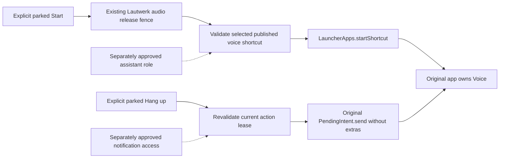

# Native voice control prototype

Version 0.3.3, draft PR #52. Based on the architecture spike in PR #51 and the
[public shortcut and action audit](evidence/control-access-2026-11-01/README.md).
This is an isolated, parked-only Android 17 experiment, not a supported Android Auto category,
shipping assistant, external session API or proof of hands-free operation while driving.

## Scope

Build with both `-PcarHandoffExperiment=true -PnativeControlsExperiment=true`. The existing experiment
entry then opens a two-app picker and a separate Start / Hang up page for the selected app. The normal
API car template, model selection, phone voice selection, keys and histories are unchanged. Without
these flags the existing launcher/assist experiment and the default single-action car template retain
their behavior. The new activities and services are debug-source-set only and disabled by default.
They do not exist in the release library. The DHU release variant remains disabled.

The temporary phone setup uses framework controls without new design tokens. Car pages use the same
host-drawn `MessageTemplate`, title, primary color request and parked-only action guard. There is no
new upstream design rule and no production UI redesign. B2/B3 stay unchanged.



## Separate consent gates

Do not grant either permission just to install or run fixture tests. Ask the user before each type
of access. The setup page only opens normal Android settings after an explanatory confirmation;
it does not change a role, enable a listener, request microphone access or start a native app itself.

1. **Assistant role:** temporarily select the Lautwerk control experiment as the digital assistant.
   Android documents shortcut-host access for the current launcher or active voice interaction
   service. The prototype does not replace the home launcher. Its system assistant gesture ends
   immediately; it provides no hotword, recording or speech recognition. Assist data and screenshots
   are disabled in metadata and through the service API. The inert recognition companion satisfies
   required service metadata; it is not selected as a recognition engine. On Android 12 and newer,
   that metadata attribute no longer selects the recognizer. Capture and verify the actual recognizer
   anyway. Restore the previous assistant and context settings after the test.
2. **Notification access:** Android's system grant covers notifications broadly. App-side filtering
   cannot narrow that grant. This implementation filters exact official packages and the current
   profile before examining foreground-service flags and action metadata. It does not read
   notification titles, bodies, extras, conversation content, remote-input values or MCP prompts.
   Reading an action label is necessary to find the published Hang up control. Revoke access after
   the bounded test. Disconnect and loss of access clear all in-memory actions.

Neither gate was exercised by the earlier action-label inspection. Permission to inspect those labels
does not authorize persistent listener access or sending an action. The new prototype requires its
own explicit test approval, including invocation of the app-published Hang up action.

## Start and end contracts

The phone setup queries manifest and dynamic shortcuts in the current user profile. The initial
manifest-only trial found no voice entry for the installed ChatGPT version, although shortcut access
was granted. The revised prototype offers only enabled entries whose label matches a voice action
already observed in the public Pixel launcher: **Audio** for ChatGPT and **Sprachmodus starten** for
Claude. It excludes entries marked as conversations or carrying a locus ID before examining labels.
Other entries are not displayed, saved or logged. This is a narrow compatibility rule, not a universal
guarantee that a publisher has classified every shortcut correctly; unknown labels fail closed. The
picker currently targets those observed labels on this German Pixel. Only the selected public ID
and package version are stored in private
experiment preferences. No shortcut intent or extras are read. An app update requires reselection.
No matching entry, lost role, locked phone or launch exception produces a fixed diagnostic message;
there is no private-intent or launcher fallback.

The existing audio release fence must acknowledge cleanup of this DHU package before dispatch.
Timeout, failure or leaving the screen cancels a pending dispatch. **Precondition:** independently
installed Lautwerk sessions and other audio conversations must already be ended. The prototype
cannot stop other packages' Lautwerk services. A 15-second start-request debounce prevents repeated
requests across page changes; expiry only permits a new explicit attempt and does not infer success
or failure. There is no automatic retry, including after reconnect or process restart.

End matching intentionally supports only the observed English/German action pairs: Hang up / Mute
and Auflegen / Stummschalten (or their Unmute counterparts). Exactly one end action in exactly one
matching foreground-service record per target must exist. Its PendingIntent creator must be the
same official package and current profile. Reply actions, null intents, unknown labels, ambiguous
records and authentication-required actions are rejected. The original app may change this UI
contract in a future update; a missing action remains unavailable instead of guessing.

Before an explicit End, re-query live records and validate the rendered lease against notification
replacement, removal, listener reconnect and action changes. Consume once before sending the original
PendingIntent with **no fill-in intent or extras**. Never persist or log the PendingIntent, notification
key or native content. A notification update does not rearm a consumed action; removal is required.
The remaining race between final validation and the app processing the action cannot be eliminated
across processes. Android may cancel an intent, reject a launch, or allow a request without the
desired native effect. Fixed results report requests, not successful native session transitions.

No Listening, Speaking, MCP-waiting or Stopped inference is made. A visible Hang up action is a control
availability signal, not proof of an active conversation. A disappearing notification is not proof
of a stopped microphone or remote session. Both apps may process microphone audio as soon as their
voice shortcut starts; a no-question test is not an offline or no-network test.

## Build, install and rollback

Use JDK 17 and the pinned SDK. Preserve the installed DHU APK and test APK first. Do not uninstall,
clear app data, spoof installer origin, or weaken host validation. Stop on a signature conflict.

```powershell
.\gradlew.bat -PcarHandoffExperiment=true -PnativeControlsExperiment=true :prototype-app:assembleDhuDebug :prototype-app:assembleDhuDebugAndroidTest :car-ui:lintDebug :prototype-app:lintDhuDebug :voice:test
adb install -r prototype-app/build/outputs/apk/dhu/debug/prototype-app-dhu-debug.apk
adb install -r -t prototype-app/build/outputs/apk/androidTest/dhu/debug/prototype-app-dhu-debug-androidTest.apk
adb shell am instrument -w -r -e class com.azentrius.lautwerk.prototype.NativeControlTest -e nativeControlsExpected true com.azentrius.lautwerk.prototype.dhu.test/androidx.test.runner.AndroidJUnitRunner
adb shell am start -n com.azentrius.lautwerk.prototype.dhu/com.azentrius.lautwerk.car.controls.NativeControlSetupActivity
```

The fixture tests use fake audio and native controls. They neither grant access nor query native
notifications. Capture current assistant, voice interaction/recognition components, assist context
settings, the prototype listener's grant state and general device settings before a consented trial.
Afterward end native sessions, revoke only the prototype's newly granted listener access, restore the
previous assistant and all changed context settings, then compare the settings snapshot. Keep other
listeners and the Pixel launcher unchanged. Reinstall the saved APKs with `adb install -r` if rolling
back; no user data reset is needed. Do not install a disabled build while it is the selected assistant
or while its listener is still authorized; restore those grants first.

## Acceptance and evidence

| Check | Required result |
| --- | --- |
| Default and release isolation | Default debug components disabled; release contains no native control services/classes |
| Missing/revoked role or listener | Fixed error, no shortcut start or End dispatch |
| Audio release failure or late callback | No native start after timeout, failure or screen exit |
| Duplicate Start/End and stale End | No duplicate dispatch, no cross-app action |
| Real DHU Start, both apps | Native voice visibly starts on the phone without a phone tap |
| Real DHU End, both apps | Native voice exits and microphone operation stops, checked independently |
| Restart | New explicit Start and End succeed without overlap |
| Native app update or unknown action | Reselection/unavailable; no guessed fallback |
| Locked phone | Start requests unlock while parked; End remains governed by the original action and Android |
| Listener disconnect/process death | Leases cleared, no automatic action; explicitly retest after reconnection |
| Network loss | No automatic retry or success claim; native recovery and native End require manual testing |
| Cleanup | Previous assistant/context/recognizer and listener state restored |

Call/headset, moving-car, live questions, network recovery and MCP approval tests remain deferred.
The [prototype test report](evidence/native-controls-0.3.3/README.md) separates fixture evidence from
native device/DHU acceptance. On the tested unlocked Pixel, both apps passed real DHU Start, Hang up
and restart, including a final-build repeat. The verdict is **GO for further supervised parked tests,
not GO for the intended hands-free product**. Locked starts are deliberately blocked. The broad
notification grant, replacement assistant role, app-version/label dependency and absent MCP status
remain product constraints. Google and the original access/settings were restored after the trial.

## Sources

- [LauncherApps shortcut access and start](https://developer.android.com/reference/android/content/pm/LauncherApps#hasShortcutHostPermission())
- [VoiceInteractionService](https://developer.android.com/reference/android/service/voice/VoiceInteractionService)
- [NotificationListenerService](https://developer.android.com/reference/android/service/notification/NotificationListenerService)
- [Notification.Action.actionIntent](https://developer.android.com/reference/android/app/Notification.Action#actionIntent)
- [Voice interaction metadata](https://android.googlesource.com/platform/frameworks/base/+/refs/heads/main/core/res/res/values/attrs.xml)
