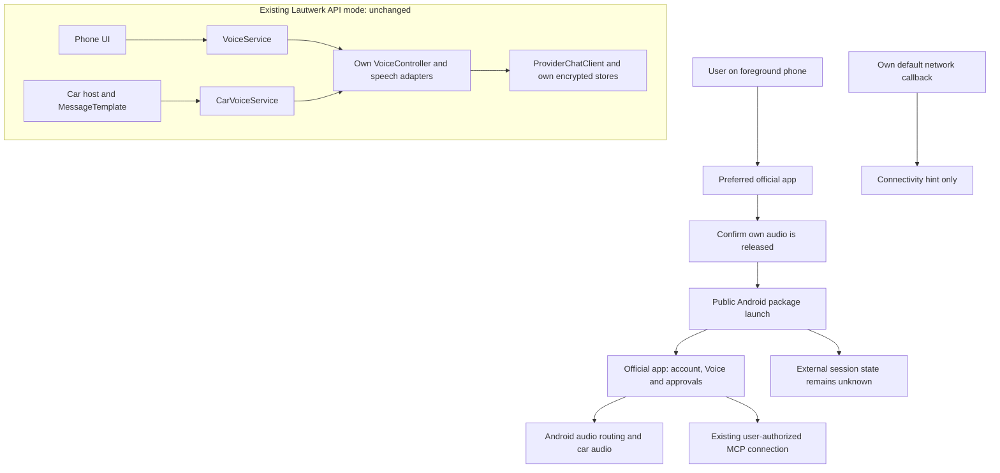

# Personal assistant handoff: architecture spike

Reviewed on 2026-11-01 against `origin/main` at `6858367`, Lautwerk 0.3.2.
This is a design decision, not an implemented operating mode.

## Decision

**Conditional GO for a user-initiated handoff on the foreground phone. NO-GO for a
Lautwerk-controlled Android Auto session with the official assistant apps.**

Opening an app is supported. Reliably starting, observing, stopping or reconnecting its voice
session requires a contract that was not found in the reviewed vendor documentation. An app
launch must not be reported as a running conversation. The narrower handoff would offer a preferred
app and setup guidance, while the user operates Voice and approvals in that app. It is not yet
ready to ship and requires the tests and approval below.

| Capability | Assessment | Boundary |
| --- | --- | --- |
| Open the official app from an unlocked, foreground phone | Conditional GO | Public Android launch API; validate installed versions and launch failures. |
| Use its personal account and existing MCP connection | User-confirmed feasibility | Owned by the official app; Lautwerk receives neither credentials nor conversation data. |
| Continue its audio through the car with the display off | User-confirmed feasibility | Not a guarantee across devices, versions, routes or session limits. |
| Start Voice deterministically from Lautwerk | NO-GO as a promise | Native settings can help, but no reviewed external start contract guarantees the required state. |
| Show live listening/speaking, pending MCP approval, or a working external Stop button | NO-GO | No authoritative inter-app signals or control contract identified. |
| Recover an external session automatically after network loss | NO-GO | No documented resume/acknowledgement contract; replay could duplicate an action. |
| Keep Lautwerk's existing API conversation mode | Required | No changes to providers, storage, audio behavior or the car template in this spike. |

Evidence labels used below:

- **Observed in source:** inspected in this checkout.
- **Documented:** supported by a linked primary source, checked on the review date.
- **User-reported:** ChatGPT Live and Claude Voice worked on Pixel 10 Pro / Android 17 with car
  microphone, car speakers, screen off and Azentrius Memory over MCP. Not repeated in this spike.
- **Inference/proposal:** architectural reasoning or a future test requirement, not measured behavior.
- **Unknown:** no dependable signal or untested behavior. Unknown never means inactive or approved.

The reported tests do not record app version codes, account configuration, Android Auto version,
audio transport, repetitions or recovery behavior. Collect these without account identifiers in a
future test. Car audio success does not establish an officially supported Android Auto app category.

## Existing architecture and integration boundaries

All rows here are source findings. Paths refer to this revision, not the older local working notes.

| Area | Source | Consequence for a handoff |
| --- | --- | --- |
| Phone entry and lifecycle | [MainActivity](../app/src/main/java/com/azentrius/lautwerk/app/MainActivity.kt) | The start gate is tied to a resumed activity. `onStop` cancels pending preparation, not an already running service. Opening another app is not an audio-release acknowledgement. |
| Phone conversation | [VoiceService](../app/src/main/java/com/azentrius/lautwerk/app/VoiceService.kt), [AndroidVoiceEnvironment](../app/src/main/java/com/azentrius/lautwerk/app/voice/AndroidVoiceEnvironment.kt) | Own microphone foreground service, recognizer/TTS and interruption handling. `START_NOT_STICKY`; screen and communication interruptions are handled for Lautwerk's own session. |
| Shared conversation flow | [VoiceController](../voice/src/main/kotlin/com/azentrius/lautwerk/voice/VoiceController.kt), [PlaybackFocusAudio](../voice/src/main/kotlin/com/azentrius/lautwerk/voice/PlaybackFocusAudio.kt) | Listen, request, speak, listen; cancellation guards reject late callbacks. Playback focus is scoped to owned output. These are not observers of another app. |
| Car entry and presentation | [LautwerkCarService](../car-ui/src/main/java/com/azentrius/lautwerk/car/LautwerkCarService.kt), [LautwerkScreen](../car-ui/src/main/java/com/azentrius/lautwerk/car/LautwerkScreen.kt) | Validated host and `MessageTemplate`. Start/End operate the local car service. Screen `onStop` closes its connection. Preserve template, B2/B3 and host validation. |
| Car audio ownership | [VoiceConnection](../car-ui/src/main/java/com/azentrius/lautwerk/car/voice/VoiceConnection.kt), [CarVoiceService](../car-ui/src/main/java/com/azentrius/lautwerk/car/voice/CarVoiceService.kt) | Local binder, owner checks, generation guards, fixed playback/microphone checks and API conversation mode. Audio-mode interruption monitoring does not identify an external assistant. |
| Car microphone cleanup | [CarMicrophone](../car-ui/src/main/java/com/azentrius/lautwerk/car/voice/CarMicrophone.kt), [SerialAudioCapture](../voice/src/main/kotlin/com/azentrius/lautwerk/voice/SerialAudioCapture.kt) | CarAudioRecord supplies PCM to recognition. Host start/stop is serialized off the UI thread. Cancellation queues release; it is not a synchronous completion signal. |
| Network and accounts | [HttpTransport](../providers/src/main/kotlin/com/azentrius/lautwerk/providers/HttpTransport.kt), [storage](../storage/src/main/java/com/azentrius/lautwerk/storage) | Own API keys and encrypted history; fixed provider endpoints, bounded timeouts, no automatic retries or redirects. No bridge to native account sessions or MCP. |
| IPC and permissions | [Phone manifest](../app/src/main/AndroidManifest.xml), [car library manifest](../car-ui/src/main/AndroidManifest.xml), [DHU manifest](../prototype-app/src/dhu/AndroidManifest.xml) | Internal voice services are not exported. Only the car entry is exposed to a validated host. Current queries cover speech services, not official assistant apps. The POI declaration remains a debug placeholder. |

The own `com.azentrius.lautwerk.action.START`, `.action.STOP`, `.extra.SESSION_ID` and
`com.azentrius.lautwerk.car.STOP` identifiers are internal contracts. Their session IDs do not refer
to native ChatGPT or Claude sessions.

**Release hazard:** `CarVoiceService.stop()` publishes an inactive state before cancelling its
controller/capture. `SerialAudioCapture` then stops the device on a shared control executor. This
orders Lautwerk capture operations, but does not synchronize a different app's microphone start.
Any future integrated handoff needs an explicit completion acknowledgement for owned capture,
recognition, TTS and focus release, with failure/timeout cancelling the launch. A fixed sleep or
`active == false` is insufficient. This is a proposed new requirement, not a change made here.

The assistant, DHU and phone prototype are separate packages with separate stores and services.
Stopping one does not stop another. A first experiment must require the user to end all Lautwerk
sessions before handoff; cross-package coordination would require a separately reviewed IPC design.

## Documented ways to open the apps

The official Play listings identify [ChatGPT, published by OpenAI](https://play.google.com/store/apps/details?id=com.openai.chatgpt)
as `com.openai.chatgpt` and [Claude, published by Anthropic](https://play.google.com/store/apps/details?id=com.anthropic.claude)
as `com.anthropic.claude`. Use normal installed apps and their public entry points, not copied
activity class names or extracted shortcut intents.

| Route | Finding and proposed treatment |
| --- | --- |
| Android package launch | `PackageManager.getLaunchIntentSenderForPackage` on API 33+ opens a package's front door without package-visibility queries. Handle `SendIntentException`. On older supported Android versions, `getLaunchIntentForPackage` can return null; use narrowly scoped package queries where necessary. No `QUERY_ALL_PACKAGES`. Dispatch/completion is not a Voice result. See [PackageManager](https://developer.android.com/reference/android/content/pm/PackageManager#getLaunchIntentSenderForPackage(java.lang.String)) and [package visibility](https://developer.android.com/training/package-visibility/declaring). |
| ChatGPT native setup | Supported mobile versions offer **Start with Voice**: opening a new or empty conversation can start Voice automatically. A generic launch can instead restore another screen. Background conversations can continue while locked, subject to native settings and limits. This is useful setup guidance, not an external start/resume API. See [ChatGPT Voice](https://help.openai.com/en/articles/20001274-chatgpt-voice). |
| Claude native setup | The documented mobile flow opens the app, then selects the Voice icon. Its Android widget's microphone starts dictation, which is not a documented full voice-conversation launch API. See [Voice mode](https://support.claude.com/en/articles/11101966-use-voice-mode) and [Android widget](https://support.claude.com/en/articles/10534883-use-the-claude-widget-on-android). |
| Vendor deep links | Claude documents `claude://code` routes and corresponding HTTPS links for Code sessions, requiring Code access. They do not establish a Voice route; do not invent `claude://voice`. No public Android Voice deep-link contract was found for either app. See [Claude mobile links](https://support.claude.com/en/articles/14898120-open-the-claude-mobile-app-with-a-link). |
| Android assistant role | `ROLE_ASSISTANT` is a system role granted with user consent; requesting it asks for the calling app to hold it. It is not a way for Lautwerk to appoint or control another app's Voice session. Do not assume either installed vendor version supports a particular role or `ACTION_ASSIST`/`ACTION_VOICE_COMMAND` contract. See [RoleManager](https://developer.android.com/reference/android/app/role/RoleManager). |
| Android Auto | `CarContext.startCarApp` supports navigation, calls and the current car app. An explicit different component is rejected. It is not a projector for arbitrary phone apps. A phone launch from a host callback is a separate, unproven background-launch path. See [CarContext](https://developer.android.com/reference/androidx/car/app/CarContext#startCarApp(android.content.Intent)). |

Limit the proposed launch to an explicit user action while the phone activity is visible and unlocked.
Respect current `IntentSender` background-launch opt-ins, including the visible-only mode on API 36+;
do not grant general background launch privileges. A host callback, foreground service or delayed
cleanup does not by itself prove that a launch remains allowed. Recheck visibility after cleanup and
cancel if the user left. See [Android activity launch restrictions](https://developer.android.com/guide/components/activities/secure-bal).

The negative findings are bounded: searches of official Android, OpenAI and Claude documentation for
Android Voice intents, deep links, shortcuts, session callbacks and approval events found the routes
above, but no supported external Voice control/status contract. Desktop shortcuts, iOS App Intents
and CarPlay documentation are not evidence for Android. A future published contract can reopen the
decision; an exported activity discovered by inspection alone cannot.

## What can be detected reliably?

| Candidate signal | What it actually establishes | Assessment |
| --- | --- | --- |
| Launch dispatch and Lautwerk lifecycle callbacks | A local request or transition occurred. | Does not prove the other activity opened, Voice began, or the session ended when Lautwerk resumed. |
| Audio focus, audio mode and recording callbacks | Audio arbitration/capture state, with API-specific visibility. | Inference only: no semantic distinction between listening, another recorder, waiting for a tool, or a paused session. Never seize focus or record audio to probe. |
| MediaSession | A media session exposed by an app, if accessible. | Neither vendor documents it as a complete Voice/MCP status contract. A media pause action must not be treated as ending a conversation. |
| Usage events / foreground package | App usage, with additional access. | Foreground does not imply Voice, and background does not imply ended. Do not request usage access. |
| Assistant notification posted/removed | A notification event, if posted and delivered to an authorized listener. | Neither presence nor absence proves an MCP request or its resolution. No stable approval notification schema found. |
| Own MCP server receives a tool call | That request reached the server. | A client may request approval before sending it. No request is indistinguishable from thinking, no tool needed, disconnection or refusal. |
| Vendor-defined session/approval callback | Would establish the documented state under its contract. | Missing in the reviewed public interfaces. Required for an authoritative integrated mode. |

Android documents [audio input arbitration](https://developer.android.com/media/platform/sharing-audio-input),
[MediaSession access requirements](https://developer.android.com/reference/android/media/session/MediaSessionManager#getActiveSessions(android.content.ComponentName))
and [usage-event access](https://developer.android.com/reference/android/app/usage/UsageStatsManager).
Those are not assistant protocols; the semantic limitations above are architectural inferences.
Do not replace missing signals with polling, ADB-only diagnostics or accessibility automation.

MCP defines tool calls and recommends human control, while leaving the client interaction model open.
It does not give Lautwerk an observer channel into another client's approval screen. OAuth connection
consent, tool-call confirmation and server-requested elicitation are different events. Server-side
observations alone cannot unify them into a reliable pending-approval flag.
See the [MCP tools specification](https://modelcontextprotocol.io/specification/2025-11-25/server/tools).

## Permission hints with minimal data

**Preferred design: no notification listener.** Show setup guidance explaining that approval may
require opening the assistant on the phone while parked. Do not claim an actual request is pending.
ChatGPT explicitly documents on-screen review for approval-requiring Live actions on mobile and no
spoken approval. See [ChatGPT Voice approvals](https://help.openai.com/en/articles/20001274-chatgpt-voice).
Claude approval presentation and notification behavior remain a manual test item, not an assumed
equivalent. Native permissions remain native; Lautwerk must never confirm on the user's behalf.

If the user later wants notification-based hints, a separately approved experiment could process
only the source package and event type after an explicit in-app explanation and Android notification
access grant. This is special access, not `POST_NOTIFICATIONS`. Android's
[notification access API](https://developer.android.com/reference/android/app/NotificationManager#isNotificationListenerAccessGranted(android.content.ComponentName))
and [NotificationListenerService](https://developer.android.com/reference/android/service/notification/NotificationListenerService)
expose notification objects; an app-side allowlist is not an OS guarantee of access to only two apps.

Proposed constraints for that optional experiment:

- Ignore non-allowlisted events immediately. Never inspect titles, bodies, extras, actions, remote
  views or pending intents; never retain notification objects or log their string representation.
- Keep only a transient, generic event hint. No persistence, telemetry, notification history,
  conversation/session IDs or collection of existing notifications. Clear on disable/disconnect.
- Describe it as an assistant notification, not an MCP permission request. Dismissal is not approval.
  In-app-only prompts and suppressed notifications remain invisible.
- No automatic confirmation, notification action invocation or spoken hint that competes for audio.
  Revoking access must immediately disable processing. User grants are never restored silently.

This optional route cannot meet reliable permission-detection acceptance criteria, even with consent.
It is excluded from the recommended first handoff scope and is not implemented.

## Proposed separation and lifecycle

The following components are conceptual; none is added by this change.

A future `ExternalAssistantLauncher` belongs outside `ModelCatalog`, provider adapters and the existing
voice services. A preferred-app enum is separate from the stored API provider/model. Native account
entitlements, voice choice and MCP configuration stay in the official app. Do not copy keys, tokens,
transcripts or memory contents through intents. Do not silently fall back to Lautwerk's paid API path.

Proposed coordinator states are `idle -> releasing_owned_audio -> launch_requested -> external_unknown`.
Launch errors return to `idle` with a fixed local error. Release timeout or loss of phone foreground
state cancels the attempt. Multiple taps must not dispatch multiple launches. After process death,
rotation or return from the assistant, external session state is still unknown. No persisted
`externalActive` flag, background monitor service, wake lock or automatic restart is justified.

Lautwerk cannot offer an external End control with the existing own-service stop action. Before
returning to API mode the user must end the native session and explicitly start Lautwerk. This
handoff is not a voice proxy: the official app owns capture, synthesis and audio routing. Successful
car audio does not mean Lautwerk can route or duplicate that audio using CarAudioRecord.

Any UI additions need a separate design-system review and approval before changing production
functions. The current car screen, actions, B2/B3, HostValidator and category declaration stay intact.

## Network loss and reconnection

A future visible phone handoff page could use `ConnectivityManager.registerDefaultNetworkCallback`
with `ACCESS_NETWORK_STATE`. `INTERNET` means configured for internet access; `VALIDATED` means the
system's probe succeeded. Neither proves reachability of a vendor, account or MCP endpoint. Observe
capabilities, unregister callbacks when no longer needed, and do not create a foreground service to
keep watching another app. See [Android network state](https://developer.android.com/develop/connectivity/network-ops/reading-network-state).

| Event | Required behavior in the proposed handoff | Unresolved native behavior |
| --- | --- | --- |
| No validated network at launch | Inform without claiming the assistant is unreachable; allow only an explicit user decision to open it. | Native cached UI and offline handling depend on the installed app. |
| Loss while listening, speaking or awaiting a tool | No automatic launch, replay, API fallback or claim that the session ended. | Whether native Voice retries, waits or ends must be measured. |
| Connectivity returns | Update only the local connectivity hint. User checks the native app. | Resume, reauthentication and pending approval restoration are unknown. |
| Tool might have completed before its response was lost | Do not retry from Lautwerk. User verifies the outcome before repeating an action. | An interrupted response does not establish that a write did not execute. |
| Wi-Fi/cellular or VPN transition | Observe the app's default network, not just Wi-Fi enabled/disabled. | Vendor routing may differ; local success is no service-health guarantee. |
| Phone locks or Lautwerk process exits | Native app owns continued operation; no watchdog or auto-resume. | Background limits and recovery need version-specific evidence. |

Inference for testing: wireless Android Auto's local Wi-Fi connection and internet connectivity are
different variables. Disabling Wi-Fi can break projection as well as internet access. Test controlled
upstream loss while preserving the car connection, then test projection loss separately. Do not
change the user's network settings in this spike.

## Risks and go/no-go gates

| Risk | Severity | Mitigation / gate |
| --- | --- | --- |
| Fake active/approval state | Blocking for integrated mode | Keep unknown; require vendor-documented authenticated state and lifecycle signals before promising control. |
| Competing microphone or focus ownership | High | Explicit stop and verified release before future launch; account for all installed Lautwerk packages. |
| Launch starts unexpected audio or restores another chat | High | Explain native settings, test cold/warm launch and Start with Voice; launch itself may use network/microphone. |
| Duplicate tool effect after reconnection | High | No replay; test interruption with read-only fixture tools, not real memory writes. |
| Notification content exposure | High | No listener in the default design; separate opt-in and privacy review for any experiment. |
| Host/lockscreen rejects a launch | High for car integration | Foreground phone scope; never bypass host, keyguard or background-launch restrictions. |
| Vendor update changes behavior | Medium | Record versions and rerun manual gates; undocumented behavior never becomes a dependency. |

**Gate H, supervised phone handoff:** require launch/error tests for both installed apps, explicit
audio release, honest unknown state, no data transfer and no regressions. A launcher shortcut alone
does not satisfy a requirement for fully hands-free use from the car display.

**Gate A, integrated Android Auto mode:** currently fails. Reconsider only with a documented Voice
start/stop/resume contract, authoritative session and permission events, an allowed car interaction
route, and device evidence for loss/recovery. Missing inputs remain open requirements, not values
or behavior to invent. Native audio success and notification heuristics cannot pass this gate.

## Test matrix and acceptance criteria

All rows are **planned, not run in this spike**, except the explicitly user-reported baseline.
Proposed repetition counts below are acceptance targets, not results. Call and headset tests remain
deferred. Vehicle tests are stationary only; no production change is authorized by this matrix.

| ID | Setup / action | Pass criterion / evidence |
| --- | --- | --- |
| T0 | Native apps, Pixel 10 Pro / Android 17, car audio, locked screen, MCP | User reports success for both. Repeat with app/version, native settings, transport and outcome recorded before claiming reproducibility. No contents or account IDs. |
| T1 | Foreground public launch, each app; cold, warm, existing conversation; ten attempts per app across these states | Correct official app opens 10/10 or a fixed failure is shown; zero claimed Voice starts from dispatch alone. Record screen category and elapsed time only. |
| T2 | App absent/disabled, signed out, microphone denied; double tap | No crash, installation/login guidance stays explicit, one dispatch per action. No private activity fallback. Use an emulator or approved test profile, not uninstalling personal apps. |
| T3 | ChatGPT Start with Voice off/on; new/empty versus existing chat; Claude voice icon versus widget dictation | Document the actual distinction and native microphone activation. No promise that dictation or launch equals a conversation. Voice tests require user readiness. |
| T4 | Own phone/DHU listening, speaking or starting; release then external launch, ten cycles | No launch before confirmed own cleanup, no overlapping owned audio or stale callbacks. Other installed package must be stopped too. Currently requires a future release acknowledgement. |
| T5 | Lock, leave phone activity during preparation, rotate, kill/recreate Lautwerk, return from native app | No unsolicited launch, automatic restart or invented active/ended state; own pending work cancelled. |
| T6 | Native MCP request: allow, deny, leave pending, cancel; screen on/off | User records where the prompt appears and whether a notification exists. Lautwerk reads no notification content and never confirms. Read-only fixture data only. |
| T7 | No notification, unrelated notification, suppressed notification; optional listener enable/disable/revoke | Default mode requests no access. Any later consented experiment reads only allowed metadata, leaks nothing and never labels an event as MCP approval. |
| T8 | Upstream loss for 10 and 60 seconds during listening, reply and pending tool request; reconnect, each app | Record native recovery/required user action; zero Lautwerk replay, fallback or duplicate launches. Any unknown tool outcome remains unknown. Preserve wireless projection separately. |
| T9 | Wi-Fi/cellular transition, captive portal, then separate projection disconnect/reconnect | Do not confuse a validated network with vendor/MCP health or projection presence. No automatic resume. |
| T10 | Regression after any future implementation | Existing JVM, all module lint and debug CI tasks green; phone start/stop/restart, storage, export and settings pass; CarTemplateTest/CarDesignContractTest and stationary DHU baseline unchanged. Calls/headsets excluded. |

A native session stopping during a network test is a measured native limitation, not necessarily a
Lautwerk regression. However, any automatic replay, false success indicator or content leakage fails
the handoff acceptance criteria. If a future product requires seamless reconnection, failure of the
native behavior is also a product-level no-go.

Record future evidence under a separate dated spike folder: environment/version summary, fixed
event names, pass/fail, timing and user-observed audio outcome. No raw notifications, chat history,
audio recordings, full device logcat, tokens or memory contents. Any screenshots require a clean
fixture and explicit content review.

## Delivery and next decision

This change contains only this concept and a README link. No app code, manifest, permission,
dependency, version, design asset, device setting or installed app changes. No provider calls or
assistant sessions were started. No notifications were read.

No executable prototype is justified yet: a generic launcher would not resolve the missing session
and approval contracts, and using the existing Start/End flow would change production semantics.
If the narrower phone handoff is accepted, propose a separate, isolated launcher test APK first,
without provider integration, microphone capture, notification listener or car registration. Test
only public entry points with the user ready for native auto-start behavior. Review those results
and the audio-release design before requesting approval for production integration.

The source audit and documentation review support the decision above. Device acceptance, native
recovery tests and new UI design remain open. Required repository CI runs on this documentation PR;
its results are linked in the PR rather than presented as evidence of native app interoperability.
