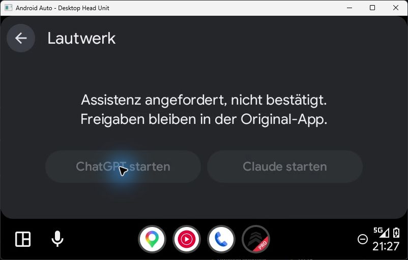

# Public assist entry: Pixel 10 Pro / Android 17

Tested on 2026-11-01, extending the unmerged 0.3.3 branch at `800a90b`.
The code and procedure are described in [ASSIST_EXPERIMENT.md](../../ASSIST_EXPERIMENT.md).

**NO-GO for direct native voice start through the tested `ACTION_ASSIST` route.** Android allowed
the observed starts, but the apps did not enter a usable native voice conversation. Selecting each
app temporarily as Android's default assistant did not change that result. No private entry point,
accessibility automation, root, system-service binding or background-launch bypass was used.
The earlier [package-launcher opening result](../handoff-0.3.3/README.md) remains a separate result.
The user's previously successful, manually started native car audio is not contradicted by this test.

## Environment

| Item | Version |
| --- | --- |
| Pixel 10 Pro | Android 17, API 37, security patch 2026-10-05 |
| Lautwerk DHU | 0.3.3-prototype / 303, both experiment properties enabled |
| Android Auto | 17.9.664044-release / 179664044 |
| DHU | 2.0-windows, build 2022-03-30-438482292, protocol 1.7 |
| Host Car API | 8, captured in the fixed event log |
| ChatGPT | 1.2026.293 / 2629319 |
| Claude | 1.261030.19 / 26103019, newer than the earlier launcher test |

## Results

| Route and setup | Observed result | Evidence |
| --- | --- | --- |
| ChatGPT assist, Google remains default | No physical-display visibility observed. User missed the first observation and requested a repeat; on repeat, confirmed no change or error. No Voice start. | [First observation](chatgpt-unlocked.json), [synchronized repeat](chatgpt-repeat.json) |
| Claude assist, Google remains default | Resumed/focused on physical display 0. User confirmed the normal Claude interface only. No Voice start. | [Observation](claude-unlocked.json) |
| ChatGPT assist, ChatGPT selected as default | No physical-display visibility observed. User confirmed no change or error. No Voice start. | [Observation](chatgpt-default.json), [system diagnosis](chatgpt-default-system.json) |
| Claude assist, Claude selected as default | User again confirmed only the normal Claude interface. No Voice start. | [Observation](claude-default.json) |
| Standard build checks | Full CI JVM/lint/debug task list successful; 110 JVM test results have no failures and were up to date because their sources did not change. | [Build summary and APK hashes](build-result.json) |
| Opted-in build | Assist APK, test APK and DHU lint successful. Manifest inspected for `HANDOFF_EXPERIMENT=true` and `HANDOFF_ENTRY=assist`. | [Build summary](build-result.json) |
| Device fixtures | 19 tests pass, including public intent boundaries, lock delegation, no fallback/retry, localized handoff states, existing car template and B2/B3 contract. No native app launched by instrumentation. | [Instrumentation output](instrumentation.txt) |
| Visibility parser | Four existing fixtures pass, including virtual-display rejection. | [Build summary](build-result.json) |
| Restoration | Original Google assistant, all five sampled assistant settings and all eight general settings restored. | [Assistant comparison](assistant-settings-restored.json), [before](settings-before.json), [after](settings-restored.json) |

The [fixed event log](events.txt) distinguishes `entry=ASSIST` from the earlier package launcher.
Android's [sanitized system summary](system-launch-summary.json) contains matching assist starts
with `BAL_ALLOW_BOUND_BY_FOREGROUND`, rather than a background-launch denial. A normal app return
alone would not establish this. An earlier query against the main log buffer yielded no matching
system events; the subsequent query explicitly used the system buffer. Empty logs are not proof
of a block. Native implementation reasons remain unknown; no private app code was inspected.

Observation offsets include time before the manual click, so they are not launch latency.
The observer never equates visibility, focus or a normal launch return with an active voice session.
Native chat screens, microphone audio, account identifiers and notification content were not saved.
All live launch triggers were real DHU clicks, not ADB or instrumentation starts of the native apps.
ADB opened only the normal Android settings UI for the separately authorized role comparison.

## Cleanup and remaining work

Google was restored through Android's normal role confirmation. Android had reset both context
switches to off during role changes; the original enabled state was restored through the visible
Google assistant settings switch. Equality was verified for assistant, voice interaction service,
voice recognition service, assist structure and assist screenshot settings. The existing language,
theme, font scale, network, Bluetooth and TTS settings were unchanged. The DHU exited normally and
the test's ADB port forward was removed. No app was uninstalled and no app data was cleared.
The assist opt-in APK remains installed; the local standard APK is available for rollback.

No test question or MCP approval was sent. With no direct voice start established, stop/restart,
screen-off conversation, cold locked start, routing and network recovery were not attempted.
Calls, headsets and vehicle tests remain deferred. No claim of reliable pending-MCP detection or
working external Stop is made. The current parked-only experiment does not deliver the requested
hands-free driving mode and must not be presented or merged as that completed feature.

A further experiment needs a separately justified public route or a documented native auto-start
setting verified on the installed app. Declaring an assist handler or selecting the assistant role
was not sufficient. Do not introduce private voice intents or guessed extras to turn this result
into a reported success.
