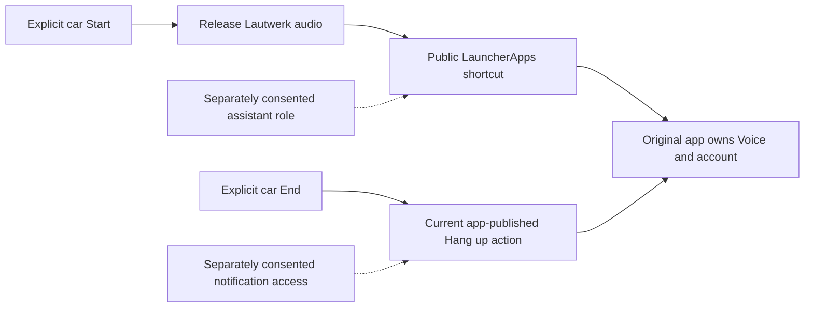

# Public shortcuts and control-access audit

Date: 2026-11-01. Repository baseline `4601c61c76774e6ad8e842f8322f04f66b429156`, draft PR #52.
Pixel 10 Pro, Android 17 / API 37. ChatGPT 1.2026.293 / 2629319 and Claude 1.261030.19 / 26103019.
This continues the [widget test](../native-widget-voice-2026-11-01/README.md).

## Results

| Check | Result | Evidence |
| --- | --- | --- |
| ChatGPT public launcher shortcut | **Audio** entered native Voice, with microphone access and the native End control | Observed Pixel launcher menu and app UI; [result.json](result.json) |
| Claude public launcher shortcut | **Start voice mode** entered native Voice, with microphone access and the native End control | Same method; exact German labels in [result.json](result.json) |
| Legacy `ACTION_CREATE_SHORTCUT` activity | Neither package resolved an activity | Read-only package-manager query, not a claim about modern shortcuts |
| Shortcut access under the ordinary Lautwerk UID | `hasShortcutHostPermission()` was false; both package-specific shortcut queries threw `SecurityException` | [Opt-in instrumentation](instrumentation-opt-in.txt), [fixed events](access-events.txt) |
| Foreign media-session access under the Lautwerk UID | `MEDIA_CONTENT_CONTROL` denied; both Android 17 package-specific queries threw `SecurityException` | Same two-test run |
| ChatGPT media controls, Voice foreground and background | Session inactive, action mask 0, no custom actions in both samples | Filtered system diagnostic; no contents or session tokens retained |
| Claude media controls, Voice foreground and background | Session active, mask 516: PLAY and PLAY_PAUSE, no STOP, no custom actions | Same filtered diagnostic |
| ChatGPT ongoing Voice notification | **Hang up** and **Mute**, each with a non-null action intent | Explicitly user-authorized action-only inspection; no action invoked |
| Claude ongoing Voice notification | **Hang up** and **Mute**, each with a non-null action intent | Same consented inspection |
| Cleanup | Both microphone operations inactive; Google assistant and Pixel launcher unchanged | Final Android queries |

The shortcut launches were real phone-launcher actions, not DHU or Lautwerk launches. The native End
buttons on the phone closed the test sessions. No question was spoken or sent by the test driver.
The two background comparisons kept microphone access active with the home launcher visible, then
returned through each package's public MAIN/LAUNCHER entry and ended normally. This is not a cold
or locked-phone test, an acoustic conversation test, or a proof of remote session state.

Media action samples describe the quiet Voice/listening phase only. They do not establish actions
during a spoken answer or every possible app state. No unsupported media Stop/Pause command was
sent. In particular, a play/pause toggle is not treated as ending Voice.

## Test under the app's actual identity

[AssistantControlAccessDeviceTest](../../../prototype-app/src/androidTestDhu/java/com/azentrius/lautwerk/prototype/AssistantControlAccessDeviceTest.kt)
is isolated to the DHU instrumentation source set and opt-in through `assistantControlsAudit=true`.
It asserts that the process UID is the target app UID. It does not adopt a shell identity, launch an
assistant, retrieve a private intent, read returned shortcut contents or retain media-session tokens.

The unchanged baseline must have neither a launcher/active voice-interaction role for Lautwerk nor
media-control permission. Unexpected access fails the audit rather than reading the returned data.
The test checks Android's permission boundary, not whether the native shortcuts themselves work.

```powershell
.\gradlew.bat -PcarHandoffExperiment=true -PcarHandoffEntry=assist :prototype-app:assembleDhuDebugAndroidTest :prototype-app:lintDhuDebug
adb install -r prototype-app\build\outputs\apk\androidTest\dhu\debug\prototype-app-dhu-debug-androidTest.apk
adb shell am instrument -w -r -e class com.azentrius.lautwerk.prototype.AssistantControlAccessDeviceTest -e assistantControlsAudit true com.azentrius.lautwerk.prototype.dhu.test/androidx.test.runner.AndroidJUnitRunner
```

Only the test APK was updated. No production/assistant APK, app data or installer origin changed.
The opt-in run passed both tests and recorded four access denials. A second run without the argument
produced two assumption skips (`INSTRUMENTATION_STATUS_CODE: -4`), even though the runner's summary
says `OK (2 tests)`: see [default-run output](instrumentation-default.txt). It did not query the apps.

The targeted test build and DHU lint passed. The complete existing CI task list then passed locally:
all JVM tasks, every Android module's lint, all debug APKs and device-test APKs. The 110 unchanged JVM
results were up to date with zero failures/errors. See [build summary](build-summary.json).

## Consented notification-action inspection

The user explicitly permitted only inspection of the running Voice notifications' action buttons,
without notification text, stored content or persistent listener access. This was a separate grant
after the shortcut/media checks. No notification was read before that grant.

The diagnostic used `dumpsys notification --package <one exact target package>` with Android's
redaction left enabled. A local filter retained only currently posted foreground-service records
for that package and extracted action labels plus whether an action intent exists. It discarded
notification titles, bodies, extras, identifiers, timestamps, intent descriptions and all other
sections before output. No raw dump was saved and no notification listener was installed or enabled.

Android 17 prints named flags, including FOREGROUND_SERVICE. An initial filter expecting hexadecimal
flags matched zero records; this was corrected before reporting the actual action results. A parser
miss was not interpreted as an absent notification. The final samples each matched one current
foreground-service record, with **Auflegen** and **Stummschalten**, and both action intents present.

The action intents were neither extracted for replay nor invoked. The diagnostic records their
presence only. Their effects, cancellation behavior and availability to a normal authorized listener
remain untested. No MCP prompt or notification was approved, interpreted or monitored.

## Proposed next prototype and decision

**Conditional GO for an isolated public-contract prototype; no product GO yet.** There are now
concrete native start and end candidates. Keep the existing API mode, car template and parked-only
guard unchanged. Do not turn the successful phone tests into a claim of hands-free car control.



The public Android contracts support this investigation, with important conditions:

- [LauncherApps](https://developer.android.com/reference/android/content/pm/LauncherApps#hasShortcutHostPermission())
  restricts shortcut access to the current launcher or active voice interaction service. An optional
  Lautwerk voice-interaction service is a candidate; merely requesting an assistant activity is not
  enough. A temporary role trial must be separately approved and restore Google's original settings.
- [Notification.Action](https://developer.android.com/reference/android/app/Notification.Action#actionIntent)
  exposes the app-provided operation for the user to invoke. A future implementation would keep the
  current action in memory, call it without guessed extras or private component names, reject stale
  actions, and never persist or reverse-engineer its underlying intent.
- A [NotificationListenerService](https://developer.android.com/reference/android/service/notification/NotificationListenerService)
  requires explicit user authorization. The system grant is broader than an app-side package filter.
  Disclose that limitation. Filter the two packages and the current Voice control record before
  accessing anything else; do not read titles, message text, remote-input replies, extras or MCP
  prompts. Present only controls supplied by the original app, with explicit user selection and
  no automatic action or confirmation.
- A successful send, disappearing notification or media pause is not a supported conversation-state
  acknowledgement. Show a request result honestly and establish actual stop, microphone release and
  restart through device/DHU acceptance. Never label an unknown native state as stopped.

The next authorization would be different from this action-only inspection: an isolated prototype
and temporary Android role/listener permissions, with a concrete build and restoration procedure
prepared before asking. None of those permissions was granted here. No notification action was sent.

Required acceptance: real DHU Start and End, expired action handling, restart without overlap,
locked-phone behavior and car routing. Call/headset tests remain deferred. No moving-vehicle,
network-recovery or MCP test was performed.

Sources for the other boundaries: [MediaSessionManager access](https://developer.android.com/reference/android/media/session/MediaSessionManager#getActiveSessionsForPackage(java.lang.String,android.content.ComponentName)),
[PlaybackState actions](https://developer.android.com/reference/android/media/session/PlaybackState#ACTION_STOP),
[AOSP notification dump filtering](https://android.googlesource.com/platform/frameworks/base/+/refs/heads/main/services/core/java/com/android/server/notification/NotificationManagerService.java),
[AOSP action-field output](https://raw.githubusercontent.com/aosp-mirror/platform_frameworks_base/master/services/core/java/com/android/server/notification/NotificationRecord.java).
